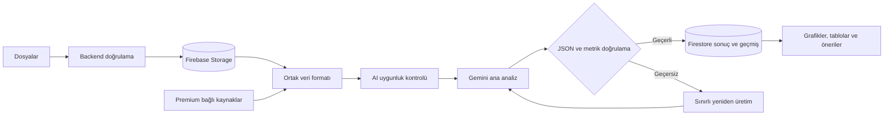

# Incagen — Ürün ve Sistem Akışı

Bu belge planlanan ürün davranışını anlatır; mevcut uygulama yalnız dosya seçen bir frontend prototipidir. Kesinleşmemiş altyapı ve kapsam seçimleri [GOAL.md](GOAL.md) içindeki açık kararlardadır.

## Free ve Premium

Ürün limitlerinin tek kaynağı bu tablodur.

| Özellik | Free | Premium |
|---|---|---|
| Günlük analiz hakkı | 10 | 30 |
| Analiz başına maksimum dosya | 10 | 30 |
| Analiz derinliği | Medium | High |
| Harici veri kaynakları | Bulunmaz | Google Analytics ve Microsoft Clarity |
| Web sonucu | Grafikler, tablolar ve öneriler | Daha derin karşılaştırma ve öneriler |

Dosya boyutu limitleri geliştirme/test aşamasında belirlenecektir. Günlük kotanın saat dilimi ve sıfırlama politikası uygulanmadan önce kararlaştırılacaktır.

## Dosya kabulü ve hazırlama

Seçicide CSV, TSV, XLS/XLSX, ODS, PDF, DOC/DOCX, TXT, RTF, Markdown, PPT/PPTX, JSON, XML ve görseller bulunur. Seçilebilir olmak, formatın backend'de işlenmesinin tamamlandığı anlamına gelmez.

1. Kullanıcı dosyalarını seçer ve analizi onaylar.
2. Backend kimlik, plan/kota, MIME, uzantı, boyut ve güvenlik kontrollerini yapar; istemcinin accept filtresine güvenmez.
3. Kaynak dosyalar yetkilendirilmiş Firebase Storage alanına alınır.
4. Dosyalar metin, tablo, görsel ve kaynak referansları içeren ortak formata hazırlanır.
5. Düşük maliyetli, yapılandırılabilir AI uygunluk kontrolü yapılır. Geçersiz dosyalarda anlaşılır hata ve geçerli dosyalarla devam için kullanıcı onayı sunulur.

## Analiz ve sonuç hattı

Yeniden üretim sınırlı olmalıdır; sınır aşıldığında iş hata durumuna geçer. Kesin sayısal metrikler ve kaynak referansları backend doğrulamasından geçmeden kullanıcıya gösterilmez. AI anahtarları frontend'e verilmez.

Arka plan işinin durumu, doğrulanmış JSON sonucu ve geçmiş kayıtları Firestore'da tutulur. Kullanıcı sonuçlarını ve önceki analizlerini buradan izler. Çalıştırma/kuyruk servisleri ile saklama ve silme politikası henüz seçilmemiştir.

Kullanıcıya teknik servis isimleri yerine “Dosyalarınız hazırlanıyor”, “İşletme verileriniz analiz ediliyor” ve “Sonuçlarınız görselleştiriliyor” gibi işlem durumları gösterilir.

Sonuç; özet, KPI kartları, grafikler, karşılaştırmalı tablolar, bulgular, yapılacak/kaçınılacak işler, öncelikli öneriler ve veri kalitesi uyarılarını içerir. Bulgularda kaynak ve güven düzeyi gösterilir; kanıtsız yorumlar çıkarım olarak etiketlenir.

## Model ve entegrasyonlar

Planlanan ana model `gemini-3.8-flash`; Free için `medium`, Premium için `high` düşünme seviyesidir. Projenin kampanya/maliyet planı gereği 31 Aralık 2026 tarihine kadar bu model hedeflenir; sonrasında model ve fiyatlar yeniden değerlendirilir. Model erişimi ve fiyatları entegrasyon sırasında doğrulanır; bu ifade uygulanmış entegrasyon veya fiyat garantisi değildir.

Premium harici kaynaklarında önce Google Analytics, ardından Microsoft Clarity entegre edilir. Ödeme uygulama işi roadmap'teki Premium milestone'unda tutulur.
