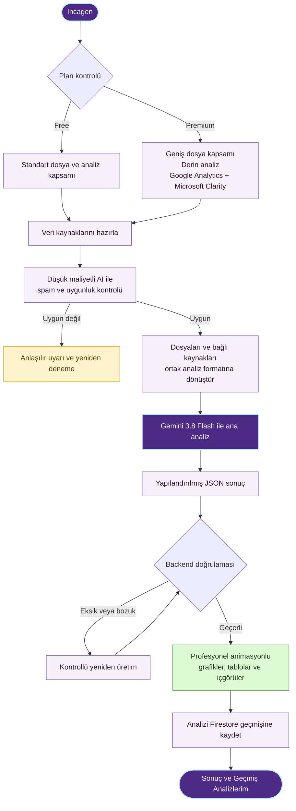
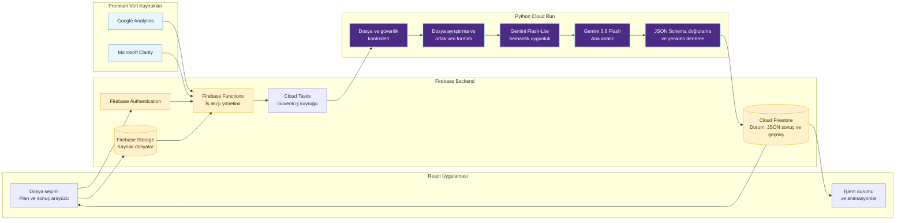

# Incagen — Ürün ve Sistem Akışı

## Plan ayrımı

| Özellik | Free | Premium |
|---|---|---|
| Aylık analiz | 5 | 30 |
| Analiz başına dosya | 5 | 20 |
| Dosya başına boyut | 25 MB | 50 MB |
| Analiz derinliği | Gemini 3.8 Flash `medium` | Gemini 3.8 Flash `high` |
| Çıktı | Güvenilir web ve PDF raporu | Daha derin karşılaştırma ve önerilerle web ve PDF raporu |
| Harici veri kaynakları | Bulunmaz | Önce Google Analytics, ardından Microsoft Clarity |

MVP ödeme olmadan davetli Free beta olarak açılır. iyzico aboneliği ve Premium yetkileri MVP sonrasındaki milestone'da etkinleştirilir.

## Müşteri profilleri

- KOBİ yöneticisi: ilk işlevsel profil
- E-ticaret işletmesi: onboarding içinde görünür, “Yakında” durumunda pasif
- Ajans/danışman: onboarding içinde görünür, “Yakında” durumunda pasif

## Ana ürün akışı



## Firebase ve AI veri hattı



## Kullanıcıya gösterilecek işlem aşamaları

Teknik servis isimleri ve spam kontrolü kullanıcıya gösterilmez. Arayüz yalnızca kısa ve güven veren durumlar gösterir:

```text
Dosyalarınız hazırlanıyor
Verileriniz güvenli şekilde işleniyor
İşletme verileriniz analiz ediliyor
İçgörüler ve öneriler oluşturuluyor
Sonuçlarınız görselleştiriliyor
```

## Sonuç yapısı

Geçerli JSON sonucu frontend aşağıdaki profesyonel bölümlere dönüştürür:

- Genel özet ve temel KPI kartları
- Animasyonlu grafikler ve karşılaştırmalı tablolar
- Önemli bulgular ve nedenler
- Yapılması gerekenler
- Kaçınılması gerekenler
- Önceliklendirilmiş öneriler
- Veri kalitesi veya eksik bilgi uyarıları

## Temel teknik kararlar

- İlk kullanıcı profili KOBİ yöneticisidir; e-ticaret ve ajans/danışman profilleri işlev kazanana kadar pasif gösterilir.
- MVP, Avrupa bölgelerinde ayrı Firebase dev ve prod projeleriyle davetli beta olarak yayınlanır.
- Firebase Authentication Google ve e-posta/parola girişini destekler.
- MVP tek kullanıcıyla çalışır; veri modeli gelecekteki ekip üyeliği için `workspaceId` içerir.
- Desteklenen formatlar CSV, TSV, XLS/XLSX, ODS, PDF, DOC/DOCX, TXT, RTF, Markdown, PPT/PPTX, JSON, XML ve görsellerdir.
- Analizler arka plan işi olarak yürür; kullanıcı sekmeden ayrılsa bile Firestore üzerinden durum ve geçmiş korunur.
- Ana analiz modeli `gemini-3.8-flash` olacaktır.
- Gemini 3.8 Flash, kampanyalı fiyatların geçerli olduğu 31 Aralık 2026 tarihine kadar kullanılacak; sonrasında güncel model ve fiyat seçenekleri yeniden değerlendirilecektir.
- Free analizlerde `medium`, Premium analizlerde `high` düşünme seviyesi kullanılacaktır.
- MIME, uzantı, boyut, checksum ve zararlı içerik kontrolleri deterministik yapılır; semantik uygunluk yapılandırılabilir Gemini Flash-Lite modeliyle değerlendirilir.
- Model yanıtı tanımlı JSON şemasına uymak zorundadır; geçersiz yanıt kontrollü şekilde yeniden üretilir.
- Kesin oranlar ve sayısal metrikler backend tarafından doğrulanmadan kullanıcıya gösterilmez.
- Firebase Functions yetkilendirme ve orkestrasyonu, Cloud Tasks iş kuyruğunu, Python Cloud Run ise dosya ve AI işlerini yürütür; anahtarlar frontend'e verilmez.
- Kaynak dosyalar Firebase Storage'da tutulur.
- Analiz durumu, doğrulanmış JSON sonuçları ve geçmiş analiz kayıtları Cloud Firestore'da tutulur.
- Kaynak dosyalar ve sonuçlar kullanıcı silene kadar saklanır; silme işlemi tüm ilişkili verileri kalıcı olarak temizler.
- Geçmiş Analizlerim ve markalı PDF çıktısı MVP kapsamındadır.
- Premium ödeme altyapısı iyzico ile kurulur; Google Analytics ilk, Microsoft Clarity ikinci harici entegrasyondur.
