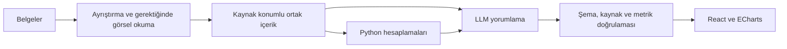

# Incagen — Ürün ve Sistem Akışı

## Çalışan yerel dikey akış

E-posta/parola veya Google ile kayıt → korumalı çalışma alanı → farklı iş belgelerini seçme → yerel Storage yüklemesi → Functions içerik doğrulaması ve ayrıştırma → kaynak konumlu hazırlık özeti → geçmişten açma veya kaynaklarıyla silme.

Tam analiz akışı `npm run dev:emulator` ile yalnız `demo-incagen` Firebase emülatörlerinde çalışır; gerçek buluta fallback yoktur. Bu akışta yalnız sentetik veriler kullanılmalıdır. Backend desteklenen belgelerin içeriğini deterministik olarak ayrıştırır; AI yorumu henüz eklenmedi.

Canlı Netlify derlemesi ve `npm run dev` ile açılan yerel önizleme aynı uygulama ekranlarını ve rotalarını gösterir; gerçek Firebase e-posta/parola kaydı, Google ile giriş, çıkış ve şifre yenileme bağlantısı çalışır. Oturumsuz “Analize başla” landing üzerindeki giriş modalını açar; geçerli oturum varsa doğrudan çalışma alanına geçer. Storage, Cloud Functions ve güvenlik kuralları canlı projeye dağıtıldı; tam kullanıcı akışı canlıda doğrulanana kadar önizleme yalnız Auth kullanır. Bu sürede belge hazırlama ve hesap silme sunucuya gönderilmez; geçmiş verisi okunmaz ve ekranda durum açıklanır.

Oturumlu çalışma alanında Incagen logosu yeni analiz ekranına gider. Çalışma alanındaki “Nasıl çalışır?” yardım bağlantısı, anlatımın bulunduğu temiz `/` ana sayfa adresini açar; ana sayfa üstünde yinelenen yardım düğmesi yoktur. Eski `/#nasil-calisir` adresi `/` ile değiştirilir. İç sayfa gezinmesi tarayıcı geçmişine eklenir, böylece geri/ileri düğmeleri gerçek ekranlar arasında çalışır. Tanıtım bölümü mevcut belge hazırlama ve arşiv adımlarını açıklar; henüz etkin olmayan AI yorumlarını çalışan özellik gibi göstermez. Canlı Auth görünümünde geçmiş kayıtları okunmaz; boş durum kartı yeni analiz ekranına geçiş sağlar.

## Dil ve rapor deneyimi

Arayüz Türkçe, İngilizce, Almanca, İspanyolca, basitleştirilmiş Çince ve Arapça sunulur. Dil seçimi tarayıcıda korunur; rota, oturum ve taslak sıfırlanmaz. Dil adları seçili dilde gösterilir. Arapça RTL yerleşim, sayılar/tarihler seçili yerel biçimi kullanır. Kullanıcı girdileri ve özgün kaynak belgeler çevrilmez. Kaynaklar [dil rehberinde](docs/LOCALIZATION.md) tanımlıdır.

Raporlarda özet ve bulgular öndedir; tablolar, yönetim notları, kaynak dosyaları ve yöntem ayrıntıları açılır bölümlerde korunur. Bölüm bağlantısı kapalı ayrıntıyı açar. Kurumsal performans ve insan etiketli müşteri deneyimi örnekleri aynı bulgu/kaynak bileşenlerini kullanır; genel `AdaptiveReport` sayısal veri olmadan metin raporu sunabilir ve eksik ölçümü sıfır yapmaz. Örnekler model/servis çağırmaz, kullanıcı hesabına yazılmaz. Yeni örnek `/ornek-rapor/musteri-deneyimi` yolundadır; kaynak yorumlar özgün dillerinde kalır.

Açılır pencereler, içerik dışındaki fare tıklaması veya dokunmayla kapanır. İçerideki etkileşimler, dışarı taşan sürükleme ve devam eden silme işlemleri kapatılmaz; Escape ve odak dönüşü korunur. Ortak davranış [dil ve rapor rehberinde](docs/LOCALIZATION.md#pencere-kapatma) açıklanır.

Destek ve yardım, kısa yanıtlar ile ayrı bir iletişim adımı sunar; mesajlar kişisel destek içindir. Analiz sonrası yayınlanabilecek kullanıcı geri bildirimleri ayrı veri akışıdır. Ayarlar, veri alanları ve gelecek yayın kapsamı [destek rehberinde](docs/SUPPORT.md) tanımlıdır. Sayfa/oturum/veri yüklemelerinde gerçek içerik düzenini koruyan ortak iskelet kullanılır; sahte yüzde veya ek bekleme uygulanmaz.

Ana sayfa, korumalı ekranları ve belge/veri servislerini ilk açılışta yüklemez. Kimlik oturumu aynı Firebase uygulamasında izlenir; çalışma alanı kodu ilgili rotada, genel yardım kodu ilk yardım isteğinde yüklenir. Yardım bir kez açılınca kapanması gönderilmemiş mesajı silmez. Ekranlar yüklenirken çalışma alanı sağlayıcısı yerinde kalır; dosya taslağı ve devam eden yükleme korunur.

Analiz hedefi örnekleri tıklama anındaki arayüz dilinde eklenir. Birden fazla örnek denenirse tek “Geri al” ilk hedef metnini geri getirir; bu kayıt aynı oturumdaki sayfa/dil gezinmesinde korunur. Kullanıcı hedefi elle düzenlediğinde eski geri alma kaydı kaldırılır; yeni metin eski örnek işlemiyle ezilmez. Dil değiştirmek mevcut hedefi otomatik çevirmez. Başarılı hazırlık yeni çalışma için hedefi ve geri alma kaydını birlikte temizler.

Kurumsal örnek raporun bölüm bağlantıları seçili dönemle birlikte URL'ye yazılır. Doğrudan bağlantı, yenileme ve geri/ileri ilgili kapalı ayrıntıyı açıp hedefe kaydırır; aynı bölüm tekrar seçilince de kapalı içerik açılır. Yeni dönem seçimi bölüm adresini ve açılmış ayrıntıları sıfırlayıp genel bakışı gösterir. Bilinmeyen bölüm adresleri işleme alınmaz. Grafik/kaynak kullanım açıklaması bir kez gösterilir; tablolar, bulgular ve özgün belgeler korunur.

### Hazırlama sırasında kullanıcı kontrolü

Çalışma kaydı açma, dosya aktarımı ve belge hazırlama farklı istemci aşamalarıdır. Yüzde yalnız aktarılan baytlardan hesaplanır; %100 aktarım, hazırlığın veya AI analizinin bittiği anlamına gelmez. Hazırlama aşaması gerçek backend yanıtını bekler; açık hata veya belge incelemesi başarılı sonuç gibi gösterilmez. Yeni analiz ekranındaki ayrıntılı durum, başka bir iç sayfada tek kompakt duruma dönüşür; işlem ve taslak aynı sağlayıcıda yaşar. Oluşturma/yükleme iptalinde dosyalar korunur; yeniden deneme aynı içerik için mevcut idempotency anahtarını kullanır.

Yerel dosyalar seçiliyken veya işlem sürerken `beforeunload` dinleyicisi bağlanır; tarayıcı destekliyorsa yenileme/sekme kapatmada native ayrılma onayı ister. Bu özellik otomatik kayıt değildir; cihaz/tarayıcı ve kullanıcı etkileşimi koşullarına bağlıdır. İç sayfa gezinmesini engellemez. Dosyalar temizlenince, başarılı hazırlık taslağı temizleyince veya oturum sağlayıcısı kaldırılınca dinleyici kaldırılır.

Tarayıcı çevrimdışı bildirdiğinde çalışma alanında tek bir bağlantı notu görünür; yeniden çevrimiçi olunca kaldırılır. Bu sinyal backend sağlığı veya internete erişim garantisi değildir. Taslağı değiştirmez, iş başlatmaz, düğmeleri kalıcı engellemez ve otomatik yeniden deneme yapmaz. Hatalar mevcut servis yanıtlarıyla ayrı ele alınır.

Tamamlanan hazırlıkta belge adları, kategorileri, boyutları, sayfa/çalışma sayfası/slayt bilgileri ve okuma uyarıları görünürdür. MIME, parça ve karakter değerleri ortak “Teknik ayrıntılar” alanında korunur. Başarılı ayrıştırma OCR veya AI yorumu olarak sunulmaz; kısmi kapsam ve dışlanan belgeler ayrıca belirtilir.

## Free ve Premium

Ürün limitlerinin belge kaynağı bu tablodur. Frontend plan bilgileri merkezi plan kurallarında, backend uygulanmış Free sınırları ortak analiz sözleşmesinde tutulur; değişiklikte üçü birlikte doğrulanır.

| Özellik | Free | Premium (planlanan) |
|---|---|---|
| Günlük analiz | 2 | 5 |
| Analiz başına dosya | 5 | 10 |
| Analiz başına toplam boyut | 25 MB | 50 MB |
| Belge formatları | Tablo, belge, sunum, veri ve görsel | Tablo, belge, sunum, veri ve görsel |
| AI derinliği (henüz etkin değil) | Standard | High |
| Harici kaynak | Yok | Google Analytics ve Microsoft Clarity |

Premium ödeme ve yetkilendirmeleri henüz uygulanmadı. Mevcut oturumlar Free kabul edilir. Günlük kota sunucunun `Europe/Istanbul` takvim gününe göredir; işlem başında transaction ile rezerve edilir. Başarısız işlemde iade edilir; tamamlanmış analizi silmek kotayı geri getirmez. Aynı istek ve tekrarlanan çalıştırmalar çift kota tüketmez.

Uygulamadaki Plan sekmesi aktif Free sınırlarını ve Premium için planlanan adet/boyut kapasitesini karşılaştırır; Standard/High analiz derinliğini ve Premium veri bağlantılarını ürün kapsamı olarak kartlarda ve karşılaştırmada gösterir. Bu sunum model veya OAuth bağlantılarını etkinleştirmez. Premium karşılaştırma kapsamı Ayarlar’daki Google Analytics ve Microsoft Clarity kaynaklarıyla aynıdır. Premium ödeme ve yetkilendirme etkin özellik gibi sunulmaz.

## Belge hazırlama davranışı

- Free ve Premium aynı gerçek format kapsamını kullanır: CSV/TSV/XLSX, PDF/DOCX/TXT/Markdown, PPTX, JSON ve PNG/JPEG/WebP.
- Eski DOC/XLS/PPT, ODS, RTF, XML, GIF, SVG ve HEIC/HEIF güvenli dönüştürme hattı eklenene kadar kabul edilmez.
- Çalıştırılabilir veya ürün kapsamı dışındaki dosya türleri kabul edilmez. Uzantı kontrolü istemcide ve backend sözleşmesinde aynı listeden uygulanır.
- Dosya başına ayrı MB sınırı yoktur; tek dosya da analiz toplamına kadar çıkabilir. Analiz toplamı Free için 25 MB, gelecekteki Premium kapasitesi için 50 MB'dır. Analiz başına adet sınırı Free için 5, Premium için 10'dur. Premium yetkilendirmesi gelene kadar backend yalnız Free sınırını uygular.
- Dosya adı, boyutu ve içerik türü değişmez manifestte tutulur. Storage yalnız manifestte bulunan ve manifestle tam eşleşen kaynağı kabul eder; backend ayrıca gerçek dosya imzasını doğrular.
- Metin ve JSON UTF-8; tablolar satır/sütun; XLSX çalışma sayfası; PDF sayfa; PPTX slayt; görseller boyut konumuyla normalize edilir. DOCX okunabilir metne dönüştürülür.
- Formüller ve makrolar çalıştırılmaz. Parolalı, bozuk, türü uyuşmayan, yol geçişli, aşırı genişleyen veya gömülü çalıştırılabilir nesne taşıyan dosyalar reddedilir.
- Ayrıştırma sınırları: dosya başına 1 milyon metin karakteri, 50.000 tablo satırı, 200 sütun, 500.000 hücre, 50 XLSX sayfası, 250 PDF sayfası/slayt, 2.000 arşiv kaydı ve 40 MB açılmış arşiv boyutu. Görseller en fazla 40 milyon pikseldir.
- Normalize içerik gzip JSON olarak kullanıcı okumasına kapalı `derived/{uid}/analyses/{id}` alanında tutulur. Firestore yalnız hash, gerçek MIME, kategori, konum/karakter sayıları ve uyarıları taşıyan özeti saklar.
- Görseller ve metin katmanı olmayan PDF/sunum sayfaları kaynak konumuyla işaretlenir; OCR ve görsel anlamlandırma sonraki AI aşamasındadır.
- Sonuç ekranında “Belge içerikleri ayrıştırıldı — AI yorumu henüz eklenmedi” ibaresi zorunludur.
- Bazı belgeler hazırlanamazsa kısmi sonuç tamamlanmış gibi gösterilmez. `review` durumunda hazır ve reddedilen belgeler listelenir; kota iade edilir. Kullanıcı yalnız hazır belgelerle devamı açıkça onaylar veya taslağa dönüp seçimini düzenler. Tamamı geçersizse devam seçeneği yoktur. Sunucu onay token'ını mevcut incelemeyle eşler; dışlanacak belge kimliklerini istemciden almaz. Sonuçta dışarıda kalan kaynaklar ve nedenleri korunur.

Kısmi hazırlık durum geçişi `uploading → processing → review → processing → completed` şeklindedir; onaydan önce tamamlanmış rapor yayınlanmaz. Tam hata `failed` olur. Başarılı raporun v3 sözleşmesi korunur; isteğe bağlı `excludedSources` alanı dışlanan kaynakları taşır. Önceki raporlar bu alan olmadan açılmaya devam eder.

## Teknik sözleşme ve veri sahipliği

TypeScript Cloud Functions kullanılır; bugünkü belge hazırlığında Cloud Tasks ve Python Cloud Run yoktur. Sonraki AI aşaması için aşağıda tanımlanan Python işçisi ve React/ECharts sunumu seçilmiştir; Python işçisi uygulanmadı, ECharts/Motion sunumu bağımsız sentetik örnekte doğrulanır. Gelecekte bulut için ayrı dev/prod ve `europe-west1` varsayılır; tam analiz altyapısı henüz dağıtılmadı. Bölge veya saklama değişiklikleri gerçek veri kullanımı öncesinde yeniden değerlendirilir.

- `createAnalysis`: doğrulanmış başlık, işletme, zorunlu analiz hedefi ve dosya manifestiyle taslak oluşturur; istemcinin UUID istek kimliği ve içerik fingerprint'i tekrarları tekilleştirir. Hedef 1–500 karakterdir; kenar boşlukları temizlenir, boş hedef yeni hazırlıklarda reddedilir. Eski kayıtlarda hedef bulunmayabilir. Hedef değişirse aynı istek kimliği farklı içerikle tekrar kullanılamaz. Hedef sonuç ekranında görünür; mevcut hazırlama hattı bu metinden AI yorumu üretmez.
- `prepareAnalysis`: kaynak boyutu, içerik türü, imza, arşiv ve parser sınırlarını backend'de doğrular; normalize artefaktı ve hazırlık özetini kaydeder. Kısmi parser/dosya doğrulama hatasında inceleme token'ı üretir; onayda geçerli alt kümeyi yeniden doğrular. Ağ/Storage gibi sistem hatalarını kullanıcı onayıyla atlanabilir belge sorunu saymaz. Artefaktlar deneme kimliği altındadır; eski bir işin temizliği yeni denemenin kaynaklarını silemez.
- `deleteAnalysis`: silme durumuyla yeni yazmayı kilitler, dosyaları ve raporu siler. İşlem sürerken silme reddedilir; yarım kalan silme tekrar denenebilir.
- `deleteAccount`: son 5 dakika içinde parola veya Google ile yeniden doğrulanmış ve açık onay vermiş kullanıcı için yeni analiz/yükleme yazmasını kilitler; aktif işlem varsa beklemesini ister. Ham ve türetilmiş dosyaları, Firestore kullanıcı alt koleksiyonlarını, ardından Auth hesabını siler. Temizlik başarısızsa Auth hesabı kalır ve yeniden denenebilir.
- Geçmişte tekli silme kartın işlem menüsünden, toplu silme seçim modundan yapılır. Her ikisi de geri alınamaz silme uyarısı ister; toplu işlem kayıtları sırayla siler ve başarısız kalanları yeniden deneme için seçili bırakır.
- Geçmiş özeti ve arama/filtreleme yalnız kullanıcının canlı Firestore listesinden istemcide türetilir; ek kullanıcı verisi veya sorgu açmaz. Arama başlık, analiz hedefi, işletme ve hazırlanmış kaynak adlarını kapsar. Durum, dönem ve sıralama seçimleri ihtiyaç olduğunda açılan filtre bölümünde, URL'de korunur. Onay bekleyen kayıtlar “Dikkat istiyor” filtresine dahildir; toplu “Görünenleri seç” işlemi yalnız o an filtrelenen kayıtları kapsar.
- İstemci taslağı bellektedir. Sayfalar arası geçişte korunur; backend hazırlığı başarıyla tamamlanınca seçili dosyalar, analiz başlığı, analiz hedefi ve geçici yükleme durumu temizlenirken işletme adı ile son analiz bağlantısı oturumda kalır. İşletme adı ilk kullanımda istenir, aynı oturumun sonraki analizlerinde düzenlenebilir çalışma alanı özeti olarak gösterilir; yeni oturumda yeniden girilir. Doğrulama/ağ hatası veya iptalde dosya, başlık ve hedef yeniden deneme için korunur. Sunucuda kayıt `uploading → processing → completed/failed` durumlarından geçer; kısmi hazırlıkta yukarıdaki `review` onay adımı eklenir; silmede geçici `deleting` kullanılır.
- Çalışan iş için 330 saniyelik yeniden deneme koruması vardır; bu eşik 300 saniyelik Function zaman aşımını güvenli payla kapsar. Süre aşımı sonrası açık yeniden deneme eski rezervasyonu düzeltir ve yeni deneme kimliği kullanır; eski iş sonucu yeni işi ezemez. Otomatik kalıcı kuyruk henüz yoktur.
- Sonuçlar `users/{uid}/analyses/{id}`, kota `users/{uid}/quotas/{day}`, ham kaynaklar `users/{uid}/analyses/{id}/{fileId}`, server-only türetilmiş içerikler `derived/{uid}/analyses/{id}` altında tutulur. Silme iki Storage alanını da temizler.
- Kullanıcı yalnız kendi verilerini okuyabilir. Manifest dışı yükleme ve istemcinin rapor/durum/kota yazması yasaktır. Backend yetkiyi oturum token'ından alır.
- İç sayfa geçişlerinde seçilen dosyalar ve yükleme durumu korunur. Çıkışta yükleme iptal edilir ve taslak temizlenir. Sayfa yenilemede yerel dosyalar yeniden seçilmelidir; kaydedilmiş analizler geçmişte kalır.
- Google ile giriş Firebase açılır penceresiyle yapılır; ilk girişte hesap açılır, hesap seçici her seferinde gösterilir. Bir e-posta tek hesaba bağlanır; adres başka yöntemle kayıtlıysa kullanıcıya o yöntemle girmesi söylenir. Pencereyi kapatmak hata göstermez. Apple ve Microsoft seçenekleri pasiftir. Emülatörde Google girişi sahte hesap penceresiyle çalışır.
- Oturumdaki kullanıcı şifre değiştirme isteğini yalnız bağlı e-posta adresi için başlatabilir. Canlı Firebase ortamında bağlantı e-postayla iletilir; mevcut yerel emülatör gerçek e-posta teslim etmez. Yalnız Google ile giriş yapan hesapta parola bağlantısı gösterilmez; hesap silme parola yerine Google penceresiyle yeniden doğrulanır.
- Ayarlar'da Google Analytics ve Microsoft Clarity bağlantıları yalnız pasif arayüzdür; OAuth veya veri senkronizasyonu yoktur.
- Analizler kullanıcı silene kadar tutulur; mevcut emülatör verisi normal durdurmada kalıcı değildir. Gerçek müşteri için saklama/yedek politikası ayrıca onaylanmalıdır.

## Sonraki AI ve entegrasyon aşaması

### Kabul edilen hedef mimari — 2026-10-10

Dosya türüne göre ayrıştırma ve gerektiğinde görsel okuma → kaynak konumlu ortak içerik → Python ile doğrulanabilir hesaplamalar → analiz hedefi ve kanıtlarla LLM yorumlama → sürümlü sonuç doğrulaması → React/ECharts ile etkileşimli sunum.

Bu bölüm geliştirme hedefidir. Mevcut kod belge hazırlama hattını çalıştırır; AI sonuç v1 şeması ve güvenilir kaynak/metrik doğrulayıcısı [docs/AI-RESULTS.md](docs/AI-RESULTS.md) içinde tanımlanan bağımsız modüldür. Bu kapı henüz model çağrısına veya Functions uçlarına bağlanmadı. Python işçisi, OCR ve model çağrıları sonraki aşamadadır. Analiz veri paketi ile `/ornek-rapor` 12 aylık CSV/PDF/Word şirket sunumu [AI sonuç rehberinde](docs/AI-RESULTS.md#analiz-veri-paketi--v1) tanımlıdır; mevcut hazırlık kayıtları veya bulut uçları bu rapora bağlanmaz.

### Servis sorumlulukları

| Katman | Sorumluluk |
|---|---|
| Firebase Auth, TypeScript Functions, Firestore ve Storage | Oturum/yetki, manifest, kota, iş başlatma ve durumu, kaynak/sonuç saklama ve silme |
| Python işçisi | Gereken belge/OCR işlemleri, veri temizleme ve normalizasyon, deterministik metrikler ve grafik veri kümeleri |
| LLM | İçeriği anlamlandırma, kaynaklı özet ve bulgular, gerekçeli öneriler ve izin verilen grafik türlerinden öneri |
| Backend sonuç doğrulayıcısı | Sürümlü şema, kaynakların varlığı, metriklerin tutarlılığı ve grafik-veri uyumu |
| React ve Apache ECharts | Tasarım sistemine uygun grafik, tablo ve bulgu görünümü; filtreler, kaynak erişimi ve animasyon |

Mevcut TypeScript ayrıştırıcıları ve kaynak sözleşmesi korunur; ihtiyaç duyulan ağır işler Python işçisine taşınır. Python işçisinin hedef çalışma ortamı Cloud Run'dır. Uzun ve sonlu işler için Cloud Run Jobs değerlendirilir; job/service seçimi ve Cloud Tasks gereksinimi örnek işlerin süresi, yeniden deneme ve maliyet ölçümleriyle kesinleştirilir. API anahtarları yalnız backend'de tutulur.

Arka plan iş akışı mevcut UID izolasyonu, kota/idempotency ve silme garantilerini sürdürmelidir. Tekrarlanan iş çift kota tüketmemeli, eski deneme sonucu yeni sonucu ezmemeli ve silinen kaydın artefaktları gecikmiş iş tarafından yeniden oluşturulmamalıdır.

### Dosya türüne göre hazırlama

| Girdi | Hedef hazırlama yöntemi |
|---|---|
| CSV/TSV/XLSX ve tablo niteliğindeki JSON | Hücre/satır yapısını ve türleri koru; tarih, sayı, birim ve eksikleri doğrula; hesapları kodla üret |
| TXT/Markdown/DOCX ve metin niteliğindeki JSON | Başlık/bölüm ve kaynak konumlarını koruyarak okunabilir içeriği çıkar |
| PDF/PPTX | Metin, tablo ve sayfa/slayt düzenini çıkar; grafik veya görsel bağlam gereken yerde orijinal sayfa/slayt görüntüsünü de modele sun |
| Taranmış PDF, ekran görüntüsü ve görseller | Gerektiğinde OCR ve görsel model kullan; okuma belirsizliğini ve kaynak konumunu kaydet |

Ham kaynaklar korunur. Görsel bağlam yalnız düz metne indirgenmez; bütün dosyalar da ayrım yapılmadan tek model isteğine gönderilmez. Model girişindeki içerik seçimi analiz hedefi, kapsam ve token bütçesine göre yapılır; işlenmeyen/okunamayan bölümler sonuçta açıklanır. Sayısal birleştirme ve toplam hesaplarında ilgili kayıtların tamamı işlenir; metin parçalarının seçimi sayısal veri kapsamının yerine geçmez.

Her çıkarılmış içerik kaydı belge kimliği/hash'i ve mevcut sayfa, çalışma sayfası, slayt veya satır konumuna bağlı kalır. PDF/görsel için gereken konum bilgisi sürümlü sözleşmeyle genişletilir. Tarih, ondalık biçimi, para birimi veya ölçü birimi belirsizse sessiz varsayım yapılmaz. OCR/modelden çıkarılan değerler özgün kaynakla karşılaştırılır; doğrulanamayan kritik değerler kesin metrik olarak kullanılmaz.

Pandas, tablo temizleme, gruplama ve zaman serisi hesaplamaları için başlangıç tercihidir. Docling, PDF düzeni/tablo çıkarımı ve OCR için değerlendirilecek adaydır; tüm formatların aynı araca taşınması zorunlu değildir. Parser ve OCR seçimi aşağıdaki örnek belge kalite kapısından geçmelidir. Makro/formül çalıştırmama ve mevcut dosya güvenlik kontrolleri korunur.

### Hesaplama ve LLM sonuç sözleşmesi

- Analiz girdisi başlık, kaynaklar ve kullanıcının analiz hedefini içerir. Zorunlu hedef, mevcut arayüz/backend sözleşmesinde kaydedilir; AI hattının bu hedefi kullanması sonraki geliştirme işidir. Ön uygunluk kontrolü kapsam dışı veya yetersiz girdiyi belirler.
- Toplamlar, oranlar, dönem karşılaştırmaları ve istatistikler test edilmiş kodla hesaplanır. Her metrik kullanılan kayıtları, kapsamı, birimi ve hesaplama yöntemini taşır; oranlarda pay/payda, değişimlerde karşılaştırılan dönemler bellidir.
- LLM'ye ilgili kaynak parçaları, gerekli orijinal görseller, doğrulanmış metrikler, analiz hedefi ve veri sınırlamaları verilir. LLM özet, bulgu, gerekçeli öneri ve grafik önerisini bu kanıtlara bağlar. Belgelerdeki içerik sistem talimatı olarak yürütülmez.
- Müşteri yorumlarında tema/duygu sınıflandırması model çıkarımı olarak etiketlenir; sınıflandırılmış kayıtların adet/oran hesabını kod yapar. Ölçülen olgu, yorum ve öneri birbirinden ayırt edilir; kanıtsız nedensellik veya uydurma güven yüzdesi sunulmaz.
- Hedef çıktı sürümlü JSON'dur: `schemaVersion`, `summary`, `findings`, `recommendations`, `metrics`, `datasets`, `charts` ve `limitations`. Bulgular kaynak kimliklerine/konumlarına, grafikler doğrulanmış veri kümesi ve metrik kimliklerine referans verir. Kesin alan tipleri ve sürüm geçişleri uygulama sırasında JSON Schema ile tanımlanır.
- İlk v1 yapı ve güvenilir bağlam kapısı [result-contract.ts](functions/src/analysis/result-contract.ts) içindedir; [JSON Schema](docs/contracts/ai-result.v1.schema.json) koddan türetilir. Analiz kimliği/hedefi, kaynak hash/parça/konumları, metrik değer/birim/yöntem/kanıtları, veri kümeleri ve öneri bağlantıları doğrulanır. Mevcut hazırlık raporunun v3 yapısı değişmez; bu modül gerçek LLM çıktısının semantik doğruluğunu veya model entegrasyonunun tamamlandığını göstermez.
- Şemaya uygun JSON tek başına doğruluk kanıtı değildir. Backend kaynak referanslarını, iddia edilen sayıları/birimleri, veri kümesi boyutlarını ve grafik alanlarını doğrular. Başarısız doğrulama kontrollü düzeltme veya açık eksik sonuç/hata üretir; doğrulanmamış sonuç başarılı rapor olarak yayınlanmaz.
- Modelden alınan serbest Python/JavaScript/HTML kodu çalıştırılmaz. Grafik önerileri izin verilen tür ve alanlardan oluşur; görünüm uygulamanın bileşenleriyle üretilir. Gelecekte hesaplama araçları gerekirse yalnız tanımlı ve doğrulanmış işlemler çağrılır.

### Grafik ve hareket davranışı

Python doğrulanmış grafik verisini hazırlar; etkileşimli web grafiğini React içindeki Apache ECharts çizer. Renkler, tipografi, eksenler, tooltip ve mobil yerleşim uygulamanın tasarım sistemine bağlıdır.

- Zaman serisi için çizgi, kategori karşılaştırması için çubuk, yeterli sayısal gözlemde ilişki incelemesi için dağılım grafiği tercih edilir. Modelin önerisi veri türü, birim ve analiz hedefiyle doğrulanır.
- Grafik uygun veri olduğunda gösterilir. Sayısal dayanak yoksa kaynaklı metin/tablo sunulur; eksik değerler sıfır gibi gösterilmez. Model sınıflandırmasına dayanan grafikler bu çıkarımın niteliğini açıklar.
- Eksenler, birimler, dönem ve kullanılan kayıt sayısı görünürdür. Kullanıcı grafikten ilgili bulguya, bulgudan kaynak konumuna erişebilir. Filtre değişiminde metrik, grafik ve açıklama kapsamı aynı kalır.
- İlk açılış ve veri/filtre değişiminde kısa, anlamlı geçişler kullanılır. `prefers-reduced-motion` tercihinde animasyon kapatılır; içerik görünür ve kullanılabilir kalır. Büyük veri kümelerinde hareket maliyeti sınırlanır.
- Grafik bilgisi yalnız renk/hover/animasyona bağlı değildir; okunabilir metin özeti, erişilebilir veri tablosu ve klavye ile kullanılabilir kontroller sunulur. Açık/koyu tema ve mobil taşma doğrulanır.
- PDF dışa aktarımı ayrıca kapsam kararı gerektirir. Eklenirse web raporuyla aynı doğrulanmış sonuç/veri kullanılır ve grafikler son durumlarında statik olarak aktarılır.

### Uygulama sırası ve kalite kapısı

İlk dikey kesit, sentetik bir Excel, tablo içeren PDF, taranmış belge ve müşteri yorumları örnek setiyle doğrulanır. Beklenen hesaplar, çıkarılacak içerik ve kaynak konumları önceden belirlenir. İlk çıktı kaynaklı özet, doğrulanmış metrikler ve veriye uygun bir grafik üzerinden tüm hattı göstermelidir; daha derin öneriler ve grafik kapsamı aynı sözleşmeyle genişletilir.

Başlangıç referans seti [fixtures/analysis-reference](fixtures/analysis-reference/README.md) altındadır: iki sentetik CSV, elle yazılmış kaynaklı cevap anahtarları, değerlendirme protokolü ve kötü girdi varyantları. Mevcut parser, deterministik hesaplar ve referans bütünlüğü test edilir; insan tema/duygu etiketleri LLM başarısı olarak sunulmaz. Model bağlandığında cevap anahtarları modele verilmeden üç bağımsız koşu, zorunlu doğruluk/kaynak kapıları ve başlangıç 90/100 insan değerlendirme önerisi kullanılır. Excel/PDF/tarama kapsamı ve ölçülmüş süre/maliyet bütçeleri henüz eklenmedi.

Extraction/OCR doğruluğu, sayısal sonuçlar, kaynak eşleşmesi, bulgu/öneri dayanağı, grafik uygunluğu, toplam süre ve maliyet ölçülür. Kalite eşikleri ve iş bütçeleri ilk örnek seti değerlendirmesinde belirlenir. Eksik/çelişkili kaynak, okunamayan sayfa, model/şema hatası, retry, kota ve kullanıcı izolasyonu senaryoları test edilir. Modelin kendini değerlendirmesi tek kalite ölçütü değildir; beklenen sonuçlar ve insan incelemesiyle karşılaştırılır.

### Model ve diğer entegrasyonlar

Proje planındaki ana model `gemini-3.8-flash`; 31 Aralık 2026 sonrası model ve fiyatlar yeniden değerlendirilecek. Model erişimi, düşünme seçenekleri ve kampanya koşulları entegrasyon sırasında doğrulanmalıdır; mevcut kod model çağırmaz ve fiyat garantisi vermez. OCR/görsel anlamlandırma, PDF raporu ve ödeme gelecekteki işlerdir.

Mimari değerlendirmede kullanılan resmi kaynaklar: [Gemini belge işleme](https://ai.google.dev/gemini-api/docs/document-processing), [yapılandırılmış model çıktıları](https://ai.google.dev/gemini-api/docs/structured-output), [Pandas](https://pandas.pydata.org/docs/getting_started/overview.html), [Docling](https://docling-project.github.io/docling/), [Cloud Run Jobs](https://docs.cloud.google.com/run/docs/create-jobs) ve [ECharts veri geçişleri](https://echarts.apache.org/handbook/en/how-to/animation/transition/).
