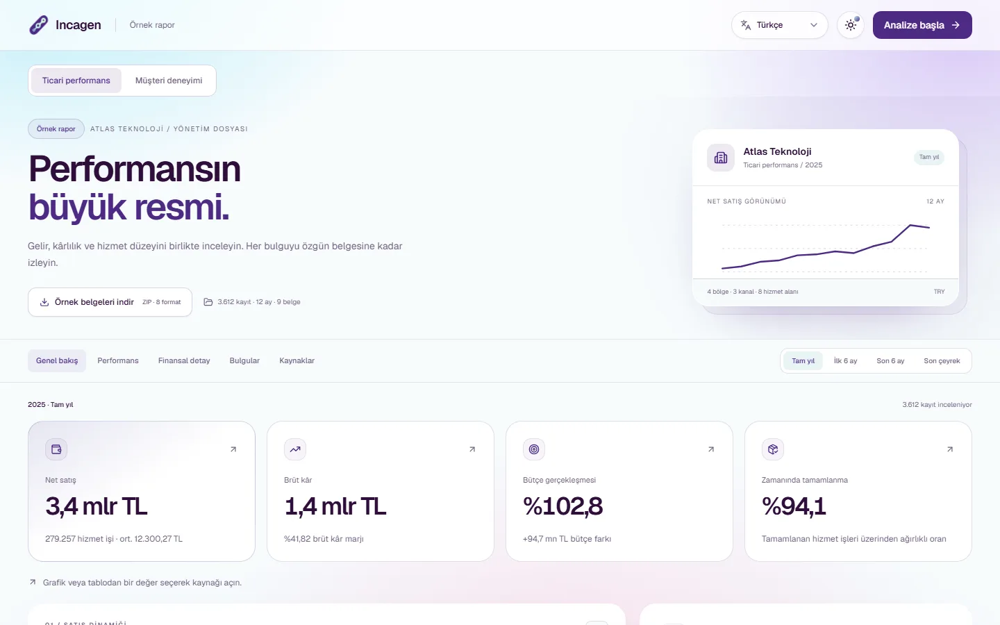
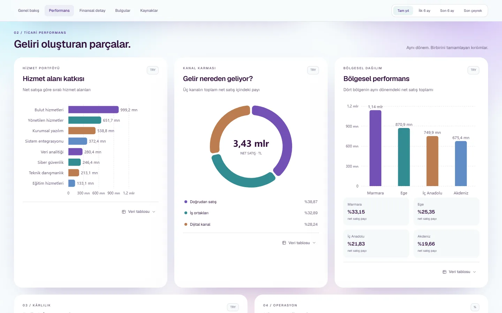
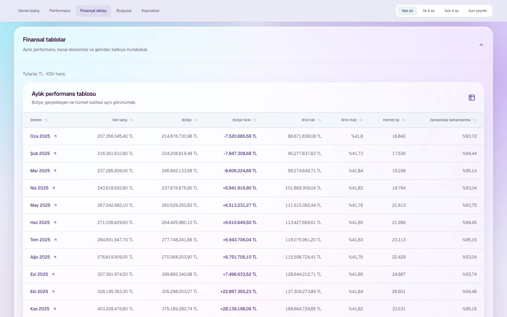
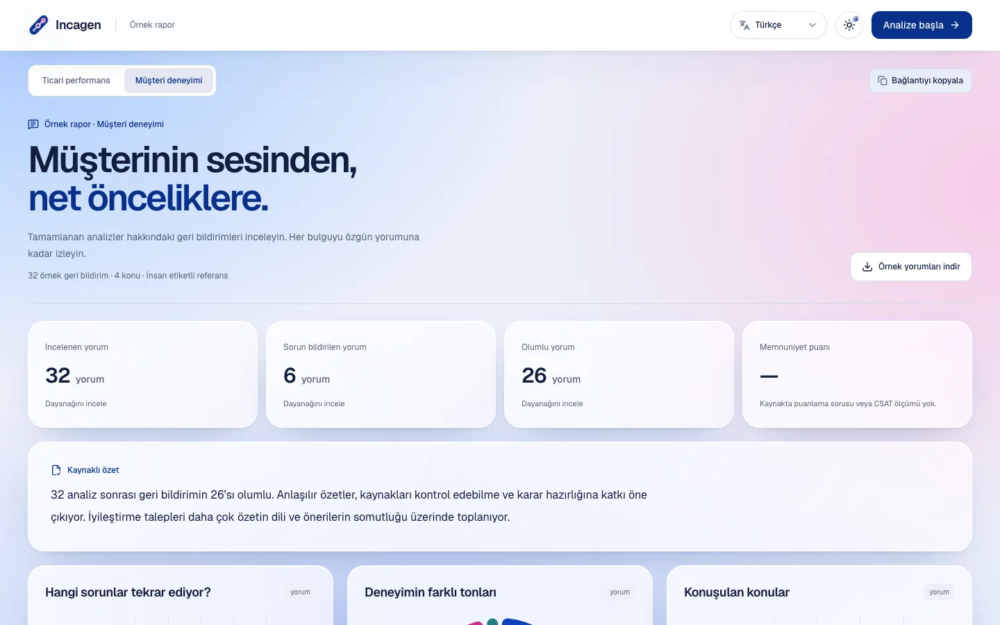
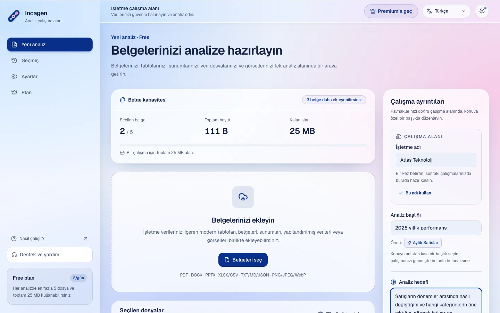

# Incagen

**Veriden karara, tek çalışma alanı.**

Incagen, işletme belgelerini, tablolarını ve müşteri geri bildirimlerini ortak bir çalışma alanında düzenler. Her çalışma belirli bir soruya odaklanır; içerik, geldiği belge ve konum bilgisiyle birlikte hazırlanır. Böylece verinin bağlamı korunur ve çalışmalar sonradan izlenebilir.

[Uygulamayı incele](https://incagen.netlify.app) · [Geliştirici rehberi](docs/DEVELOPMENT.md) · [Ürün akışı](FLOW.md)

## Ekran görüntüleri

Görseller kurgusal Atlas Teknoloji örneğinden ve sentetik bir çalışma alanından Liquid Glass görünümünde üretilmiştir; GitHub temanıza göre açık veya koyu sürüm gösterilir. Yeniden üretmek için `npm run screenshots`.

<picture>
  <source media="(prefers-color-scheme: dark)" srcset="docs/screenshots/report-overview-dark.webp">
  
</picture>

<picture>
  <source media="(prefers-color-scheme: dark)" srcset="docs/screenshots/report-charts-dark.webp">
  
</picture>

| Kaynağa bağlı tablolar | Müşteri deneyimi örneği | Çalışma alanı |
|---|---|---|
| <picture><source media="(prefers-color-scheme: dark)" srcset="docs/screenshots/report-table-dark.webp"></picture> | <picture><source media="(prefers-color-scheme: dark)" srcset="docs/screenshots/feedback-report-dark.webp"></picture> | <picture><source media="(prefers-color-scheme: dark)" srcset="docs/screenshots/workspace-dark.webp"></picture> |

## Çalışma alanı

- **Hedefi belli çalışmalar.** Analiz başlığı ve hedefi, aynı konuyla ilgili belgeleri tek bir çerçevede toplar.
- **Görünür hazırlık.** Belge adedi, toplam boyut ve kalan kapasite seçiminizle güncellenir; eksik çalışma ayrıntılarına doğrudan ulaşabilirsiniz.
- **Kaynağı izlenebilir içerik.** Ayrıştırılan içerik belge kimliği, dosya hash'i ve satır, sayfa veya slayt konumuyla ilişkilendirilir.
- **Düzenli arşiv.** Çalışmalar başlık, kaynak, durum ve dönem üzerinden bulunabilir; seçimle veya tek tek yönetilebilir.
- **Tutarlı deneyim.** Türkçe, İngilizce, Almanca, İspanyolca, Çince ve Arapça; açık/koyu tema, mobil yerleşim, klavye erişimi ve azaltılmış hareket tercihi. Ayrıntılar, bilgi kaybolmadan açılır bölümlerde sunulur.

## Çalışma akışı

1. **Soruyu belirleyin.** Müşteri geri bildirimleri, dönemsel satışlar veya başka bir iş konusu için çalışmanıza başlık ve hedef verin.
2. **İlgili belgeleri bir araya getirin.** Aynı konuya ait tabloları, metinleri, sunumları ve görselleri seçin.
3. **İçeriği kaynaklarıyla hazırlayın.** Dosyalar doğrulanır, okunabilir bölümlere ayrılır; hazırlık özeti kaynak konumlarını ve işleme uyarılarını korur.
4. **Çalışmanıza geri dönün.** Kaydedilmiş hazırlıkları arşivden açın, kaynaklarını inceleyin ve kayıtlarınızı yönetin.

## Belge kapsamı

| İçerik | Formatlar |
| --- | --- |
| Tablolar | CSV, TSV, XLSX |
| Belgeler ve sunumlar | PDF, DOCX, PPTX |
| Metin ve yapılandırılmış veri | TXT, Markdown, JSON |
| Görseller | PNG, JPEG, WebP |

Dosya türüne göre ayrıştırma kapsamı, içerik sınırları ve plan kuralları [ürün sözleşmesinde](FLOW.md#belge-hazırlama-davranışı) tanımlanır.

## Tasarım ilkeleri

**Kaynak önce gelir.** İçerik hazırlanırken belge ile bağlantısı korunur; eksik veya okunamayan kaynaklar işleme uyarılarıyla görünür kalır.

**Kurallar sunucuda uygulanır.** Dosya kabulü, kota ve erişim yetkisi istemciye bırakılmaz. Kullanıcı kayıtları oturum kimliğine göre ayrılır; tekrarlanan istekler tekilleştirilir.

**Kontrol kullanıcıdadır.** Hazırlama kullanıcı tarafından başlatılır. Taslak iç sayfalarda korunur; kalıcı silme işlemleri açık onay ister.

## Teknik temel

| Katman | Teknolojiler |
| --- | --- |
| Arayüz | React, TypeScript, Vite, React Router |
| Tasarım ve hareket | Tailwind CSS, shadcn/ui, Lucide, Anime.js, Motion, Apache ECharts |
| Backend ve veri | Firebase Auth, Firestore, Storage, TypeScript Cloud Functions |
| Sözleşmeler ve doğrulama | Zod, ESLint, Vitest, Testing Library, Playwright, GitHub Actions |

Kurulum, ortam yapılandırması, kaynak dizinleri ve test komutları [geliştirici rehberinde](docs/DEVELOPMENT.md) bulunur.

## Kalite ve geliştirme

Kalite kontrolleri bileşen davranışını, dosya ayrıştırmayı, kullanıcı izolasyonunu, kota ve silme yaşam döngüsünü kapsar. Tarayıcı senaryoları masaüstü/mobil, tema ve erişilebilirlik davranışını doğrular. [CI iş akışı](.github/workflows/quality.yml) bu kontrolleri birleştirir.

[AI sonuç sözleşmesi](docs/AI-RESULTS.md), özet, bulgu, öneri ve grafik verilerini güvenilir kaynak/metrik bağlamına bağlar. [Özetleme referans seti](fixtures/analysis-reference/README.md), sentetik satış ve müşteri yorumu vakalarıyla hesap, kaynak ve değerlendirme ölçütlerini ayrı tutar. Sözleşme ve referans bütünlüğü model çağrısından bağımsız test edilir; bağımsız [sentetik örnek rapor](https://incagen.netlify.app/ornek-rapor) hesap ve kaynak incelemesini gösterir. Gerçek model entegrasyonunun kapsamı [FLOW](FLOW.md#kabul-edilen-hedef-mimari--2026-10-10) ve [GOAL](GOAL.md) üzerinden takip edilir.

| Belge | Başvuru konusu |
| --- | --- |
| [Geliştirici rehberi](docs/DEVELOPMENT.md) | Kurulum, komutlar ve teknik kaynak haritası |
| [Test rehberi](docs/TESTING.md) / [AI sonuç sözleşmesi](docs/AI-RESULTS.md) | Kalite kapıları ve kaynak/metrik doğrulaması |
| [Dil ve rapor sunumu](docs/LOCALIZATION.md) | Dil kaynakları, RTL ve farklı analiz türleri |
| [Yardım ve geri bildirim](docs/SUPPORT.md) | Destek kanalı ve analiz sonrası geri bildirim akışı |
| [FLOW](FLOW.md) | Ürün davranışı ve sistem mimarisi |
| [GOAL](GOAL.md) | Görev sahipliği, kabul kriterleri ve açık kararlar |
| [RULES](RULES.md) / [AGENTS](AGENTS.md) | Kod, stil ve ekip çalışma kuralları |
| [MEMORY](MEMORY.md) | Kısa kalıcı proje bağlamı |

Katkılar görev sahibi ve kabul kriterleriyle hazırlanır. Sırlar, servis hesabı bilgileri ve gerçek müşteri verileri repoya eklenmez.
